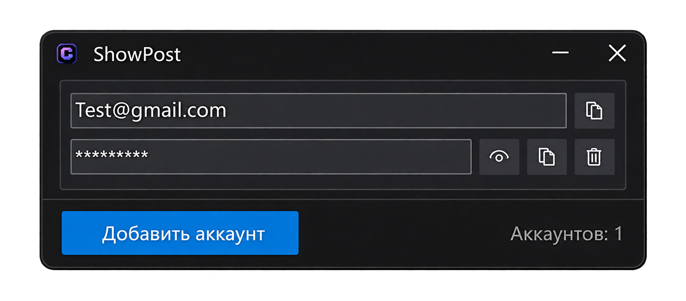

# ShowEmailList

ShowEmailList is a small portable account manager for Windows. It keeps your
email/password pairs in one place so you don't have to dig through text
files every time you need a login.

## Features

- Portable — a single `.exe`, no installer, no .NET installation required
- Accounts are blocks: email on top, password below it
- One-click copy of the email or the password (clipboard icons)
- Show/hide the password with the eye icon (passwords are masked with `*`)
- Delete an account with a confirmation dialog
- The window grows as you add accounts — no wasted space
- Everything is saved automatically to a local `accounts.json` next to the exe
- Dark UI

## Usage

1. Run `ShowEmailList.exe`.
2. Click **Add account** to create a block.
3. Type the email and the password into the block.
4. Use the icons on the right side of each block:
   - **Two squares** — copy the field to the clipboard
   - **Eye** — show or hide the password
   - **Trash** — delete the block (asks for confirmation)

## Where the data lives

All accounts are stored in `accounts.json` next to the exe — a plain,
human-readable JSON file you can back up or edit by hand.

> **Note:** accounts are stored locally in plain text (no encryption).
> Keep the file on your own machine and don't put it in shared or cloud folders.
